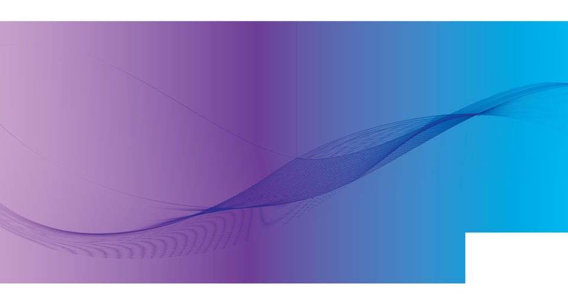

# Önder Yıldırım

**Attorney at the Istanbul Bar · Full-stack software architect · AI engineer**
Istanbul, Turkey · Turkish, English, French

Önder Yıldırım (Necmettin Önder Yıldırım) is a licensed attorney and a full-stack software architect based in Istanbul. He has practiced at [Yıldırım & Yurdaöl Law Office](https://ondery.github.io/ondery/#legal) since 2006 and has worked in software for more than 20 years. He is the founder and lead architect of [Bluetree](https://github.com/bluetreetr) (formerly LawToolsAI), a legal AI platform built with Next.js, LangGraph, RAG, and MCP.

**Portfolio:** [ondery.github.io/ondery](https://ondery.github.io/ondery/)
**Latest project:** [SignLens Trainer Studio (2026)](https://ondery.github.io/ondery/trainer-studio/)
**Email:** [ondery777@gmail.com](mailto:ondery777@gmail.com)
**LinkedIn:** [linkedin.com/in/onder-yildirim](https://www.linkedin.com/in/onder-yildirim/)
**Plain-language summary:** [llms.txt](https://ondery.github.io/ondery/llms.txt)

## Latest — SignLens Trainer Studio (2026)

[SignLens Trainer Studio](https://ondery.github.io/ondery/trainer-studio/) is the local, browser-based YOLO training studio for **SignLens**, an offline traffic-sign reader for iOS and Android.

- Python web app at `127.0.0.1`, started with a `.bat` file on Windows 11. It is not a public site. The SignLens source is private and is not linked here.
- Tuned for a 6 GB RTX 3060 laptop GPU (Ultralytics, CUDA PyTorch).
- Simple mode is a five-step wizard in plain Turkish: add photos or frames (video and YouTube) → label signs → train → test → send to iPhone.
- Presets: **Quick** 10 epochs `yolo11n` 640 batch 8; **Normal** 50 epochs; **Best** 100 epochs `yolo11s` batch 4.
- The accuracy on screen is **mAP50 read from `results.csv`**. The studio does not invent metrics.
- The iPhone step writes `ios/signlens.pt`. Codemagic converts it to Core ML.
- Also: expert hyperparameters, Roboflow YOLOv8 and GTSDB/GTSRB import, a TR/DE/Vienna sign catalog, per-vehicle speed limits (`vehicle_rules`), and pytest.

## Law and software

| | Law | Technology |
|---|---|---|
| Role | Licensed attorney, Istanbul Bar | Software architect, full-stack engineer, AI engineer |
| Organization | Yıldırım & Yurdaöl Law Office (since 2006) | Bluetree, founder and lead architect (formerly LawToolsAI). Earlier crypto and blockchain software |
| Education | LL.B., Eastern Mediterranean University, Cyprus, 2000–2004 | Software Department, Istanbul University, associate degree, 2023–2025, High Honor Student (Onur Öğrencisi) |
| Focus | Commercial, IP, transport, labor, enforcement, family | Legal tech, RAG, LangGraph, MCP, computer vision |
| Languages | Turkish, English, French | TypeScript, Python, Go, Java, PHP |

## Selected work

| Project | What it is | Stack |
|---|---|---|
| [SignLens Trainer Studio](https://ondery.github.io/ondery/trainer-studio/) | Local YOLO training studio for the offline SignLens traffic-sign reader (2026) | Python, Ultralytics, CUDA PyTorch, Core ML |
| [Bluetree](https://github.com/bluetreetr) | Multi-tenant legal AI platform. Founder and lead architect. Formerly LawToolsAI | Next.js, LangGraph, RAG, MCP, Prisma |
| [Eskici](https://github.com/eskici-app) (private) | Bulky-item pickup, tendered transport, regional warehouses, and a low-price second-hand market | Next.js, Express, Prisma, PostgreSQL, Redis, Docker, Kubernetes |
| [Tahsilat Orkestra](https://github.com/tahsilat-orkestra) (private) | Multi-tenant payment orchestration. Card data does not touch its servers | Next.js, TypeScript, Prisma, PostgreSQL RLS |
| [DeponentAI](https://github.com/deponent-ai) (private) | Signed, hash-chained content attestations without storing the files | Next.js, Prisma, LiteLLM, C2PA, ONNX Runtime, MCP |
| [Golder](https://github.com/golder-app) (private) | Gold-jewellery commerce with live pricing and a checkout price lock | Next.js, Prisma, PostgreSQL, iyzico |
| [Sera Platformu](https://github.com/seraplatform) (private) | Multi-tenant greenhouse monitoring and control over MQTT | Next.js, Auth.js, Prisma, MQTT, Leaflet |
| [Meridian Fractional](https://github.com/meridian-fractional) (private) | Fractional ownership of real-world assets on Avalanche | Next.js, Solidity, Hardhat, wagmi, viem |
| [MiLED](https://github.com/refactor-deck) (private) | Stream Deck plugin for the Xiaomi Mi LED Desk Lamp 1S, on the local network | TypeScript, Stream Deck SDK |
| [AudioForge Pro](https://github.com/refactor-deck) (private) | Stream Deck plugin for Windows volume and OBS audio filters | TypeScript, Stream Deck SDK, obs-websocket |
| [Quick Translator](https://github.com/ondery/quick-translator) | Chrome extension: in-place translation of a selection or a page, with speech | JavaScript, Chrome Manifest V3 |
| [RAGFlow](https://github.com/ondery/ragflow) | Work on an open-source RAG engine | Go, Python |
| [ONLYOFFICE](https://github.com/ondery/DocumentServer) | Document-server integration | JavaScript, Node.js |
| [Outliner](https://github.com/ondery/outliner) | Hierarchical notes | TypeScript |
| [World Cup 2026](https://github.com/ondery/world-cup-2026) | Tournament pages: scores, calendar, statistics | HTML, CSS, JavaScript |
| [NeuraFlow](https://github.com/ondery/neuraflow) | AI workflow automation with a visual builder | AI workflows |

## Stack

TypeScript, React, Next.js, Node.js, Python, Go, Java, PHP, PostgreSQL, MySQL, MongoDB, Redis, Qdrant, Docker, Linux, LangGraph, RAG, MCP, Ultralytics YOLO.

## Contact

- Email: [ondery777@gmail.com](mailto:ondery777@gmail.com)
- LinkedIn: [/in/onder-yildirim](https://www.linkedin.com/in/onder-yildirim/)
- GitHub: [@ondery](https://github.com/ondery)
- WeChat: `onderyyy`
- Location: Istanbul, Turkey

The portfolio is in English, Turkish, and French, with a dark and a light theme.
